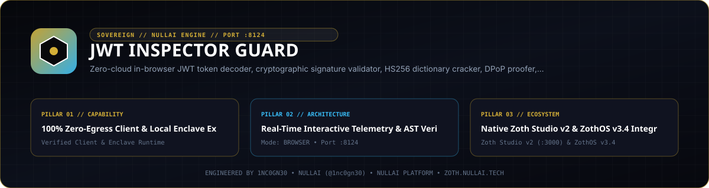
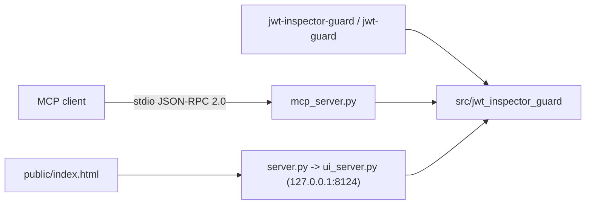

<div align="center">
  
</div>

# JWT Inspector Guard

[](https://github.com/1nc0gn30/jwt-inspector-guard/actions/workflows/ci.yml)
[](LICENSE)
[](#port)

Offline JSON Web Token (JWT / JWS) decoder, HMAC signature verifier, claims validator, security linter, RFC 9449 DPoP proof tool, and JWKS rotation simulator. Ships as a Python CLI, a stdio MCP server, a loopback REST API, and a single-file browser workstation. The Python core uses only the standard library.

- Zoth Studio v2 dossier: https://zoth.nullai.tech/tools/jwt-inspector-guard
- Source: https://github.com/1nc0gn30/jwt-inspector-guard

## What It Does

- Decodes compact JWTs into JOSE header, claims payload, and signature, with Base64URL padding normalization.
- Verifies and signs `HS256`, `HS384`, `HS512` (and `none`) using constant-time `hmac.compare_digest`.
- Validates RFC 7519 claims (`exp`, `nbf`, `iat`, `iss`, `aud`) with configurable clock-skew leeway.
- Lints tokens for known weaknesses: `alg: none` (CVE-2015-9235, including case variants such as `nOnE`), RSA/HMAC algorithm confusion, header injection (`jku`, `x5u`, `jwk`, `kid` path traversal), weak HMAC secrets, and sensitive data in the payload. Produces a score, grade, and recommendations.
- Runs a dictionary attack against HMAC-signed tokens using a built-in or custom wordlist.
- Creates and verifies RFC 9449 DPoP proofs (`htm`/`htu` binding, `ath` access-token hash, `cnf.jkt` RFC 7638 thumbprint, `jti` replay cache).
- Simulates JWKS key lifecycles (`active -> retiring -> revoked`) and audits external JWKS files.
- Benchmarks constant-time vs early-exit signature comparison to demonstrate timing side channels.

All processing happens locally. The browser UI performs decoding, auditing, and HMAC verification with WebCrypto; no token leaves the machine.

## How It Works



| Module | Responsibility |
| :--- | :--- |
| `token_parser.py`, `base64_url.py` | Compact JWT parsing and Base64URL codec |
| `claims_validator.py` | RFC 7519 temporal / issuer / audience checks |
| `crypto_engine.py` | HMAC signing and constant-time verification |
| `security_linter.py` | Vulnerability detection, scoring, secret cracking |
| `dpop_guard.py` | RFC 9449 DPoP proof creation and verification |
| `jwks_manager.py` | JWKS rotation simulation and RFC 7638 thumbprints |
| `timing_defense.py` | Comparison timing benchmarks |
| `ui_server.py` | Threaded HTTP server for `public/` and `/api/*` |
| `mcp_server.py` | JSON-RPC 2.0 MCP server over stdio |
| `cli.py` | argparse CLI dispatcher |

Additional launchers:

- `bin/jwt-guard.js` — Node wrapper. `jwt-guard web` starts `server.py` on `127.0.0.1:8124`; no arguments (or `desktop` / `--gui`) opens the Electron shell in `electron/main.cjs`, falling back to the web server if Electron is not installed; any other arguments are forwarded to the Python CLI.
- `bin/jwt-inspector-guard-tui` — Braille-sparkline terminal view (`--json`, `--benchmark`, `--frames N`).
- `jwt-inspector.desktop` — Linux desktop entry calling `jwt-guard desktop` / `jwt-guard web`.

## Install

Requires Python 3.9+. Node.js is only needed for the `bin/jwt-guard.js` launcher and the optional Electron shell.

```bash
git clone https://github.com/1nc0gn30/jwt-inspector-guard.git
cd jwt-inspector-guard
python3 -m pip install -e .

# Verify
jwt-inspector-guard --version
jwt-inspector-guard --help

# Start the web UI + REST API on http://127.0.0.1:8124
python3 server.py
# or: npm start
# or: jwt-inspector-guard serve --no-browser
```

Optional desktop shell:

```bash
npm install
npm run app
```

## CLI Reference

Entry points: `jwt-inspector-guard` and `jwt-guard` (both map to `jwt_inspector_guard.cli:main`). Global flags `--no-color`, `-q/--quiet`, `-v/--version` are accepted before or after a subcommand. Most subcommands accept `--json`. Tokens may be passed as an argument or piped on stdin.

| Command | Purpose |
| :--- | :--- |
| `--json` | Print platform and crypto diagnostics as JSON |
| `--status` | Probe `http://127.0.0.1:8124/health` and print a JSON status object |
| `decode [TOKEN]` | Decode header / payload / signature |
| `verify [TOKEN] -s SECRET [-a ALG] [--iss] [--aud] [--leeway]` | Verify signature and claims |
| `encode -p PAYLOAD [-s SECRET] [-a ALG] [--exp] [--sub] [--iss] [--aud] [--header]` | Mint and sign a token |
| `audit [TOKEN] [-s SECRET]` | Security lint report and score |
| `crack [TOKEN] [-w WORDLIST] [--max-attempts N]` | Dictionary attack on HMAC secret |
| `samples` / `catalog [-c CATEGORY] [-g NAME]` | Built-in sample tokens and CVE vectors |
| `serve [--host H] [-p PORT] [--no-browser]` | Web UI + REST API (default `127.0.0.1:8124`) |
| `mcp` | MCP stdio server |
| `diagnostics` / `doctor` / `platform` | Platform and crypto diagnostics |
| `test` | Built-in self-test runner |
| `jwks [--rotate] [-f FILE] [--resolve TOKEN]` | JWKS audit and rotation simulation |
| `timing [--test-vulnerable] [--trials N]` | Comparison timing benchmark |
| `dpop-create [-m METHOD] [-u URL] [-t TOKEN] [-n NONCE]` | Create a DPoP proof |
| `dpop-verify PROOF [-m] [-u] [-t] [-n] [--jkt] [--max-age]` | Verify a DPoP proof |

Examples:

```bash
jwt-inspector-guard catalog
TOKEN=$(jwt-inspector-guard catalog -g weak-secret-jwt)
jwt-inspector-guard audit "$TOKEN" --json
jwt-inspector-guard crack "$TOKEN"
jwt-inspector-guard encode -p '{"sub":"usr_42"}' -s 'replace-with-a-long-random-secret' --exp 3600
jwt-inspector-guard dpop-create -m POST -u https://api.example.com/v1/orders --json
```

## MCP and REST Reference

### MCP (stdio)

```json
{
  "mcpServers": {
    "jwt-inspector-guard": {
      "command": "python3",
      "args": ["-m", "jwt_inspector_guard", "mcp"]
    }
  }
}
```

Tools: `jwt_decode`, `jwt_verify`, `jwt_encode`, `jwt_audit_security`, `jwt_crack_secret`, `jwt_list_samples`, `jwt_diagnostics`, `jwt_audit_jwks`, `jwt_timing_defense_audit`, `jwt_create_dpop_proof`, `jwt_verify_dpop_proof`.

### REST (`server.py`, `127.0.0.1:8124`)

`POST` routes take a JSON body and reject cross-origin requests (Origin guard).

| Method | Route | Description |
| :--- | :--- | :--- |
| `GET` | `/health`, `/api/health` | Health and version |
| `POST` | `/api/decode` | Decode token |
| `POST` | `/api/verify`, `/api/validate` | Signature / claims validation |
| `POST` | `/api/audit` | Security lint report |
| `POST` | `/api/inspect` | Decode + validate + audit in one call |
| `POST` | `/api/catalog` | Sample tokens |
| `POST` | `/api/crack` | Weak-secret dictionary attack |
| `POST` | `/api/mint` | Sign a new token |
| `POST` | `/api/entropy` | Secret entropy estimate |
| `POST` | `/api/tamper` | Header/payload tampering helpers |
| `POST` | `/api/jwks` | JWKS audit / rotation |
| `POST` | `/api/timing` | Timing benchmark |
| `POST` | `/api/dpop/create`, `/api/dpop/verify` | DPoP proofs |

```bash
curl -s http://127.0.0.1:8124/health
curl -s -X POST http://127.0.0.1:8124/api/catalog -H 'Content-Type: application/json' -d '{}'
```

## Port

`127.0.0.1:8124` — matches the `jwt-inspector-guard` entry in Zoth Studio v2 `tools.json`. Override with `PORT` (for `server.py`, `bin/jwt-guard.js`, `electron/main.cjs`) or `JWT_GUARD_PORT` / `--port` (for `jwt-inspector-guard serve`). On ZothOS v3.4.0 the `jwt-guard` binary and `jwt-inspector.desktop` launcher use the same port.

## Testing

```bash
python3 -m pip install pytest
python3 -m pytest -q          # or: npm test
jwt-inspector-guard test      # built-in self-test
```

Server tests bind to ephemeral ports. `scripts/verify_ui.py` is an optional Playwright harness for triple-viewport UI checks against a running server (`JWT_GUARD_URL`).

## License

MIT. Copyright (c) 2026 [1nc0gn30](https://1nc0gn30.si) and [NullAI](https://nullai.tech). See [LICENSE](LICENSE).

Free and open source. Optional support: [Buy Us a Coffee (Stripe)](https://buy.stripe.com/3cIfZg27PdKo2D64Ocfw40X).
